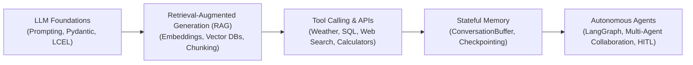

# 🧠 LLM Foundations: Complete Learning Roadmap & LinkedIn Playbook

> A structured, production-focused guide to mastering Large Language Model application development from scratch—from raw API calls to structured outputs, LCEL pipelines, and interactive web apps.

---

## 📑 Table of Contents
1. [Visual Infographic: Complete 9-Step Roadmap](#visual-infographic-complete-9-step-roadmap)
2. [The "Right Way" to Learn LLM Foundations](#1-the-right-way-to-learn-llm-foundations)
3. [Step-by-Step Curriculum Breakdown (00 to 09)](#2-step-by-step-curriculum-breakdown)
4. [The Natural Next Steps: What to Learn Next](#3-the-natural-next-steps-what-to-learn-next)
5. [LinkedIn Strategy: Why & How to Post](#4-linkedin-strategy-why--how-to-post)
6. [Ready-to-Use LinkedIn Post Templates](#5-ready-to-use-linkedin-post-templates)
   - [Post 1: The Capstone Milestone & Learning Journey](#post-1-the-capstone-milestone--learning-journey-recommended)
   - [Post 2: The 9-Step Educational Breakdown (Carousel / Long Form)](#post-2-the-9-step-educational-breakdown-carousel--long-form)
   - [Post 3: The Engineering Insight (Why Structured Output Changes Everything)](#post-3-the-engineering-insight-why-structured-output-changes-everything)
   - [Post 4: Short, Punchy Hot Take (The LCEL Pipe Operator)](#post-4-short-punchy-hot-take-the-lcel-pipe-operator)
7. [Media Checklist: What Visuals to Capture for LinkedIn](#6-media-checklist-what-visuals-to-capture-for-linkedin)

---

## Visual Infographic: Complete 9-Step Roadmap

A pixel-perfect developer infographic covering all 9 learning modules in sequence:

```
[01 Raw API & Tokens] ➔ [02 Framework Abstraction] ➔ [03 Temp Dial] ➔ [04 System vs User]
        ➔ [05 Token Streaming] ➔ [06 Prompt Templates] ➔ [07 Pydantic Output]
        ➔ [08 LCEL Chain Pipeline] ➔ [09 Capstone Web App]
```

- **Live Interactive Infographic**: [llm_foundations_infographic.html](file:///c:/study/techleadertemcode/LLMFoundation/llm_foundations_infographic.html) *(Open in browser and click "Download Ultra HD PNG")*
- **View Rendered Infographic**: See the preview in [linkedin_post_with_banner.md](file:///C:/Users/parth/.gemini/antigravity-ide/brain/28245c02-163d-4a01-bac3-9a60d912644b/linkedin_post_with_banner.md).


---

## 1. The "Right Way" to Learn LLM Foundations

Most beginners make one of two mistakes:
1. **They jump straight to complex autonomous multi-agent frameworks** (like AutoGen or CrewAI) without understanding how an LLM actually ingests tokens, formats roles, and generates text.
2. **They stay stuck in the ChatGPT / web UI chat box**, never learning how to integrate LLMs programmatically into software pipelines.

### The Correct 4-Phase Progression:
```
┌─────────────────────────────────────────────────────────────┐
│ Phase 1: Mechanics (00 - 01)                                │
│ Environment setup, API keys, tokens, raw HTTP/SDK calls     │
└──────────────────────────────┬──────────────────────────────┘
                               │
                               ▼
┌─────────────────────────────────────────────────────────────┐
│ Phase 2: Core Levers (02 - 05)                              │
│ Framework abstraction, temperature, system vs user, streams │
└──────────────────────────────┬──────────────────────────────┘
                               │
                               ▼
┌─────────────────────────────────────────────────────────────┐
│ Phase 3: Software Engineering with LLMs (06 - 08)           │
│ Reusable templates, Pydantic structured output, LCEL pipes  │
└──────────────────────────────┬──────────────────────────────┘
                               │
                               ▼
┌─────────────────────────────────────────────────────────────┐
│ Phase 4: Full-Stack Integration (09 Capstone)               │
│ UI layer (Gradio) + Chain + Validation + User Experience    │
└─────────────────────────────────────────────────────────────┘
```

---

## 2. Step-by-Step Curriculum Breakdown

Here is the exact progression implemented in this codebase (`mission1-llm-foundations`):

### `00_setup_check.py` — Environment & Tooling Hygiene
- **Core Concept**: Modern Python tooling (`uv`), environment separation (`.venv`), and API credential security (`.env`).
- **Why It Matters**: The number one reason beginners abandon LLM development is dependency conflicts and setup fatigue. `uv` ensures reproducible, ultra-fast installs (`uv sync`), and `.env` prevents accidentally pushing private API keys to GitHub.

### `01_first_llm_call.py` — The Raw API Protocol
- **Core Concept**: Communicating directly with the model via OpenAI-compatible endpoints (`base_url="https://api.deepseek.com"`).
- **Key Takeaways**:
  - LLM communication is fundamentally a list of messages: `[{"role": "system", ...}, {"role": "user", ...}]`.
  - **Tokens vs Words**: 1 token $\approx$ 0.75 words. Cost, latency, and context windows are all measured in tokens (`max_tokens`).
  - How OpenAI's protocol became the de facto standard across providers (DeepSeek, Groq, Together, vLLM).

### `02_why_a_framework.py` — The Abstraction Layer
- **Core Concept**: Comparing raw SDK boilerplate (`client.chat.completions.create(...)` + nested payload access) against a unified framework like **LangChain** (`llm.invoke(...)`).
- **Why It Matters**: Frameworks decouple model calling from model providers. Switching models from DeepSeek to OpenAI, Claude, or local Ollama requires changing one line of code, not your entire data pipeline.

### `03_temperature.py` — The Creativity & Determinism Dial
- **Core Concept**: Temperature controls the probability distribution over token sampling (0.0 to 1.0+).
  - `0.0`: Deterministic, greedy decoding, ideal for analytics, finance, code generation, and structured data.
  - `0.7 - 0.9`: High variance, creative brainstorms, marketing copy, idea exploration.
- **Why It Matters**: Production systems need reliability. Setting `temperature=0.0` or `0.1` is critical whenever software downstream needs predictable formatting.

### `04_system_and_user_roles.py` — The Architecture of Prompt Roles
- **Core Concept**: Separating persona/guardrails (`SystemMessage`) from input data/task (`HumanMessage`).
- **Demonstration**: The exact same incident text produces an engineering RCA when given an SRE persona, but an executive summary when given a Business Manager persona.
- **Why It Matters**: System prompts establish tone, behavioral boundaries, and output rules; human messages deliver dynamic runtime user context.

### `05_streaming.py` — Real-Time UX & Time-to-First-Token (TTFT)
- **Core Concept**: Generating text via Server-Sent Events (SSE) with `.stream(...)` instead of blocking on `.invoke(...)`.
- **Why It Matters**: While total generation time is similar, perceived latency drops from 4 seconds of blank waiting to instantaneous word-by-word reading. Essential for all chat and interactive interfaces.

### `06_prompt_templates.py` — Reusable Parametric Logic
- **Core Concept**: `ChatPromptTemplate` turns static prompts into parameterized functions with named placeholders (`{customer}`, `{issue}`, `{next_step}`).
- **Why It Matters**: Hardcoded string formatting (`f"..."`) becomes unmaintainable. Templates enforce clean separation of code, dynamic variables, and prompt engineering logic.

### `07_structured_output.py` — Bridging Free Text to Reliable Software
- **Core Concept**: `.with_structured_output(UseCaseBrief)` leveraging **Pydantic** schemas.
- **Why It Matters**: Free-form text is fragile and breaks downstream code. Pydantic guarantees typed attributes (`domain: str`, `business_value_score: int`, `complexity_score: int`), turning unpredictable natural language into reliable JSON/Python objects.

### `08_chain_lcel.py` — LangChain Expression Language (LCEL)
- **Core Concept**: Composing components with the pipe operator:
  $$\text{chain} = \text{prompt} \mid \text{llm} \mid \text{parser}$$
- **Why It Matters**: Unix philosophy in Python. Calling `chain.invoke(values)` automatically executes variable injection $\to$ model call $\to$ string parsing in a single, readable, streaming-compatible line.

### `09_capstone_use_case_app.py` — Full-Stack Discovery Assistant
- **Core Concept**: Bringing all components together into a user-facing web app using **Gradio**:
  - Interactive UI for problem inputs
  - Temperature toggle (Conservative, Balanced, Creative)
  - LCEL chain with Pydantic structured output
  - Formatted business markdown report with score breakdowns

---

## 3. The Natural Next Steps: What to Learn Next

After mastering these foundations, here is the roadmap to becoming an **AI Agent Engineer**:



1. **RAG (Retrieval-Augmented Generation)**: Grounding LLM responses in private documents (PDFs, Notion, SQL databases) using vector embeddings and chunking strategies.
2. **Function Calling & Tools**: Giving the LLM the ability to invoke external Python functions, search the web, run SQL queries, and trigger APIs.
3. **Agent Workflows (LangGraph)**: Building cyclic graphs with Human-in-the-Loop (HITL), error self-correction, branching logic, and persistent state.
4. **Evaluation & Observability**: Tracing LLM calls with LangSmith or Phoenix, measuring hallucination rates, and benchmarking output quality.

---

## 4. LinkedIn Strategy: Why & How to Post

### Why Share Your Learning Publicly?
- **Proof of Work**: Anyone can post an opinion on AI; very few people share working code, clean architectures, and runnable prototypes.
- **Recruiter & Client Magnet**: Engineering managers and AI leads look for developers who understand production concepts like **structured outputs**, **token budgeting**, and **reliable pipelines**.
- **Solidifies Learning**: The best way to prove you understand a concept is explaining it simply to others.

### Best Practices for Maximum Engagement:
1. **Hook in the first 2 lines**: LinkedIn truncates posts after 3 lines with "...see more". Your opening lines must create curiosity or challenge a common misconception.
2. **Show, Don't Just Tell**: Always attach a screenshot of your terminal, your Gradio app, or a clean architecture diagram.
3. **Format for readability**: Use whitespace, bullet points, and short 1-2 sentence paragraphs.
4. **Include a Call to Action (CTA)**: Ask a thought-provoking question at the end to spark comments.

---

## 5. Ready-to-Use LinkedIn Post Templates

Here are 4 copy-paste ready LinkedIn posts tailored to your code and experience. Choose the one that fits your current mood, or post them over 2 weeks!

---

### Post 1: The Capstone Milestone & Learning Journey (RECOMMENDED)
*Best for: Showing that you built a complete project from foundational principles.*

```text
Most people think building with AI starts with complex multi-agent frameworks.

I took the opposite approach: I built from the absolute foundation up.

Over the past week, I went deep into the mechanics of LLM application engineering using Python, LangChain, and DeepSeek. 

Here is the 9-step progression from a blank script to a working interactive web app:

1️⃣ Raw API Mechanics: Calling models over HTTP, understanding token budgets, and OpenAI-compatible endpoints.
2️⃣ Framework Abstraction: Why LangChain exists and how it isolates provider-specific boilerplate.
3️⃣ The Temperature Dial: Why temperature=0.0 is non-negotiable for deterministic data extraction vs 0.7 for creative brainstorming.
4️⃣ System vs User Roles: How changing persona framing alters technical SRE incident analysis vs business executive impact.
5️⃣ Streaming: Slashing perceived latency with token-by-token streaming loops.
6️⃣ Prompt Templates: Decoupling prompt structure from runtime variables with ChatPromptTemplate.
7️⃣ Structured Output with Pydantic: The single biggest unlock—forcing LLMs to return validated, typed objects instead of unpredictable strings.
8️⃣ LCEL Chains: Building readable data flows using the pipe operator:
    chain = prompt | model | parser
9️⃣ Capstone App: Built an "AI Use-Case Discovery Assistant" with a Gradio web interface that takes messy business problems and outputs structured implementation roadmaps.

The biggest takeaway? 
LLMs aren't magic chatbots; they are probabilistic compute engines. When you combine them with Pydantic validation and declarative LCEL chains, they become dependable software building blocks.

Next up on my roadmap: Tool calling, RAG pipelines, and LangGraph agents.

What was your biggest 'aha' moment when you moved from prompting in ChatGPT to coding with LLM APIs? Let's discuss in the comments! 👇

#ArtificialIntelligence #MachineLearning #Python #LangChain #GenerativeAI #SoftwareEngineering #DeepSeek
```

---

### Post 2: The 9-Step Educational Breakdown (Carousel / Long Form)
*Best for: High engagement and saves/shares. Can also be exported as a PDF carousel.*

```text
Want to learn LLM application development without getting overwhelmed by AI hype?

Here is the exact 9-step curriculum I followed to master LLM engineering from scratch:

📌 Step 0: Tooling Hygiene
Use `uv` for lightning-fast package management and `.env` files for API keys. Never hardcode credentials.

📌 Step 1: Call the Raw API First
Before touching any framework, make an OpenAI-compatible API call manually. Understand messages, roles, and token limits.

📌 Step 2: Understand Why Frameworks Exist
A framework shouldn't add bloat; it should unify providers. Switching between OpenAI, DeepSeek, Claude, or Ollama should only require changing one line of code.

📌 Step 3: Master the Temperature Dial
- 0.0: Greedy decoding for facts, finance, and code.
- 0.7+: Exploratory sampling for ideation.

📌 Step 4: Separate System from Human Prompts
System = Who the AI is (tone, guardrails).
Human = What the AI must do (dynamic data).

📌 Step 5: Implement Streaming
Waiting 5 seconds for a response feels broken. Streaming tokens as they generate keeps users engaged.

📌 Step 6: Parameterize with Prompt Templates
Stop using messy string concatenation (`f"..."`). Use structured templates with named placeholders.

📌 Step 7: Enforce Structured Outputs
Free-form text breaks production pipelines. Use Pydantic BaseModel to enforce strict types, fields, and integer scores.

📌 Step 8: Chain Components with LCEL
Compose pipelines cleanly using Unix-style pipes:
`chain = prompt | llm | output_parser`

📌 Step 9: Ship a Runnable UI
Wrap your chain in Gradio or Streamlit. An AI pipeline is only as good as the problem it solves for real users.

Save this post for your AI learning journey! 🔖

Which of these steps do you find most challenging when building LLM apps?

#LangChain #Python #AIEngineering #LearningInPublic #GenerativeAI #Coding
```

---

### Post 3: The Engineering Insight (Why Structured Output Changes Everything)
*Best for: Establishing technical authority and discussing architecture.*

```text
The moment an engineer transitions from "AI enthusiast" to "AI developer" happens when they stop asking LLMs for paragraphs and start demanding Pydantic models.

When you call an LLM with free text:
❌ You get back conversational filler ("Sure! Here is your answer...")
❌ You have to write brittle regex to extract numbers
❌ Downstream databases crash when formatting slightly shifts

Here is the pattern that solves this:

```python
from pydantic import BaseModel, Field

class UseCasePlan(BaseModel):
    recommended_use_case: str = Field(description="The single best AI use case")
    business_value_score: int = Field(description="Score from 1 to 10")
    complexity_score: int = Field(description="Score from 1 to 10")

structured_llm = llm.with_structured_output(UseCasePlan)
plan = structured_llm.invoke("I work in logistics. We manually triage shipment delays...")
```

Now, `plan.business_value_score` is a real Python integer. 
`plan.recommended_use_case` is a typed string.

No regex. No parsing errors. No hallucinated schema.

If you are building LLM applications for enterprise software, structured output isn't optional—it is the foundation of reliability.

How are you handling LLM output validation in your projects? Are you using Pydantic, Instructor, or custom JSON schema?

#Python #SoftwareArchitecture #LangChain #Pydantic #GenerativeAI #AI
```

---

### Post 4: Short, Punchy Hot Take (The LCEL Pipe Operator)
*Best for: Quick engagement, mobile-friendly feed browsing.*

```text
Python developers used to write 25 lines of boilerplate just to format a prompt, call an LLM, and parse the response.

With LangChain Expression Language (LCEL), it looks like this:

`chain = prompt | llm | StrOutputParser()`
`result = chain.invoke({"input": data})`

It's the Unix philosophy applied to AI pipelines:
Input ➡️ Transformation ➡️ Output.

Simple. Declarative. Easily composable.

Are you a fan of the LCEL pipe syntax, or do you prefer explicit function calls? Let me know below! 👇

#Python #LangChain #AI #CleanCode #Developer
```

---

## 6. Media Checklist: What Visuals to Capture for LinkedIn

Posts with visual proof receive **3x to 5x higher reach** on LinkedIn. Here are 3 quick media assets you can generate directly from this project:

| Asset | How to Capture | Where to Use |
| :--- | :--- | :--- |
| **Gradio Web UI Demo** | Run `uv run 09_capstone_use_case_app.py`, open `http://127.0.0.1:7860`, fill the form, click submit, and take a screenshot or 10-second GIF. | Post 1 or Post 2 |
| **Terminal Output of Structured Output** | Run `uv run 07_structured_output.py` and take a clean screenshot of the terminal showing typed scores and prototype steps. | Post 3 |
| **LCEL Code Snippet** | Screenshot of `08_chain_lcel.py` (lines 33–46) using a clean IDE dark theme. | Post 4 |

---
*Created as part of the AI Agentathon Foundation Series.*
